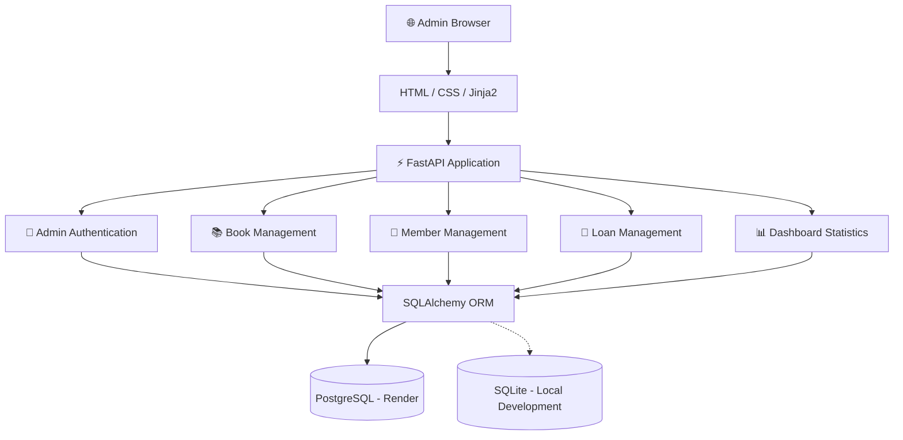
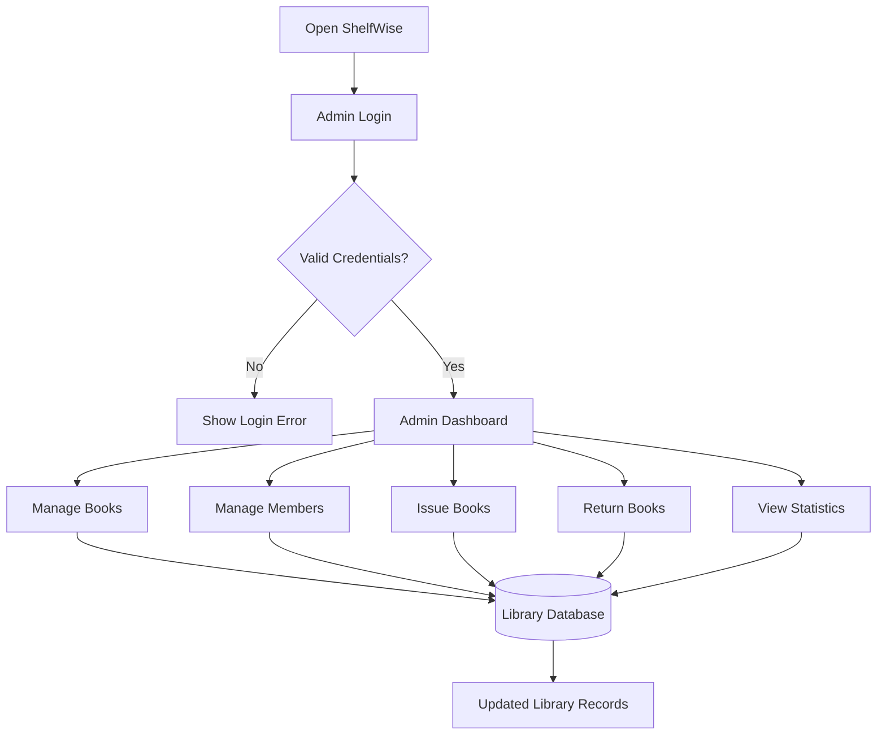
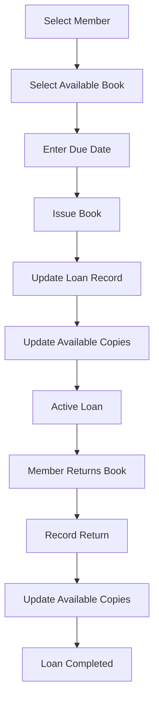
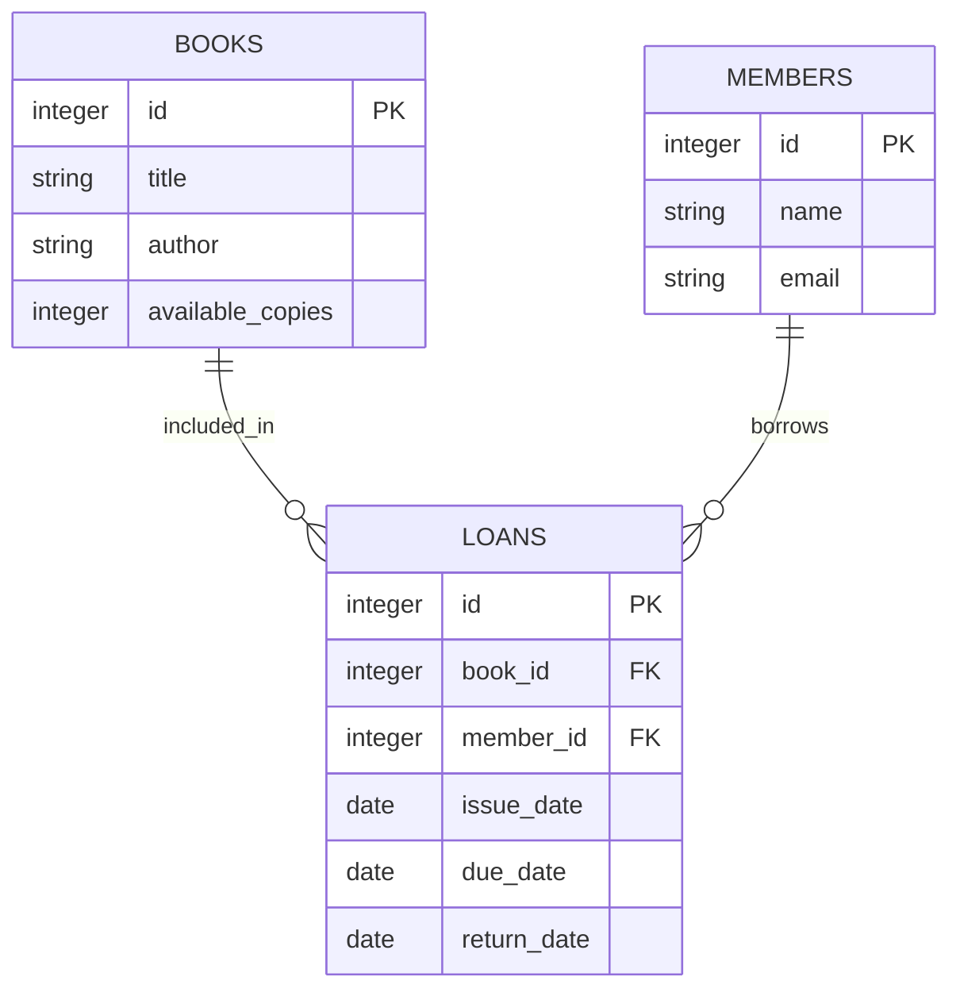
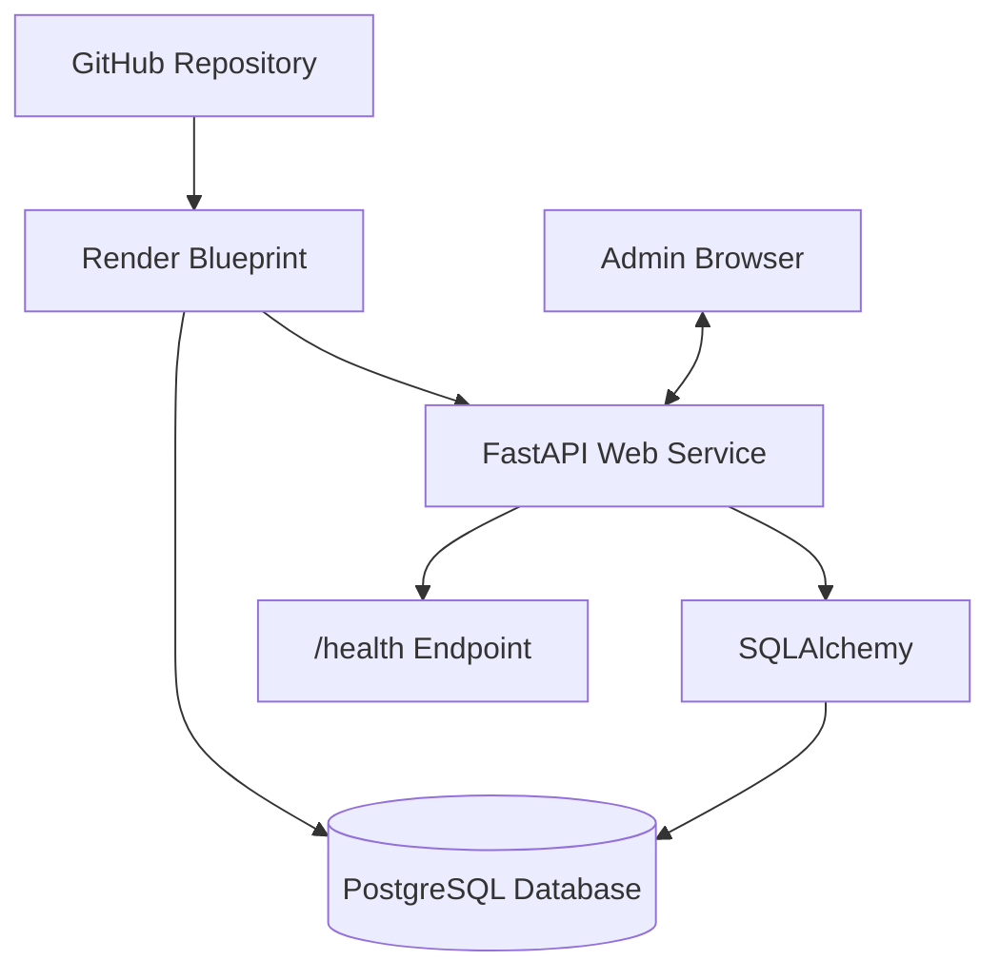

# 📚 ShelfWise — Library Management System

### Simplify Library Operations. Manage Books. Track Members. Stay Organized.

<p align="center">
  
  
  
  
  
  
  
</p>

<p align="center">
  <b>One platform to organize books, manage members, and track library circulation.</b>
</p>

---

## 🌐 Live Application

<badge color="success">Deployed on Render</badge>

**Live Website:** https://shelfwise-library-2e6m.onrender.com

**Health Check:** https://shelfwise-library-2e6m.onrender.com/health

ShelfWise is a web-based library management system built using FastAPI, Jinja2, SQLAlchemy, and PostgreSQL. It provides an administrative interface for managing library books, members, and borrowing activities.

## 📖 Project Overview

**ShelfWise Library Management System** is designed to simplify everyday library administration through a centralized web application.

Library administrators can manage book records, maintain member information, issue books, record returns, and monitor overdue loans from a dashboard.

The application uses PostgreSQL when deployed on Render and supports SQLite as a lightweight database option for local development.

## 🎯 Project Objectives

- Digitize basic library management operations.
- Maintain organized book and member records.
- Simplify book issuing and returning.
- Track available book copies.
- Monitor active and overdue loans.
- Provide a centralized administrative dashboard.
- Support both local development and cloud deployment.
- Use relational database management through SQLAlchemy.

## ✨ Key Features

| Feature | Description |
|---|---|
| 🔐 Admin Login | Secure access to the administrative interface |
| 📊 Dashboard | View book, member, active-loan, and overdue counts |
| 📚 Book Management | Add, search, and delete book records |
| 👥 Member Management | Add, search, and delete member records |
| 📖 Issue Books | Issue books to members with a due date |
| ↩️ Return Books | Record returned books and update available copies |
| ⏰ Overdue Tracking | Monitor loans that have passed their due dates |
| 🗄️ PostgreSQL Support | Use PostgreSQL for deployed application data |
| 💾 SQLite Fallback | Support local development with SQLite |
| ❤️ Health Check | Monitor application availability through `/health` |
| ☁️ Cloud Deployment | Deploy through Render Blueprint configuration |

## 🖥️ Dashboard Overview

The administrative dashboard provides a centralized view of library operations.

### Dashboard Statistics

- **Total Books:** Overview of book records.
- **Total Members:** Number of registered library members.
- **Active Loans:** Books currently issued.
- **Overdue Loans:** Loans whose due dates have passed.

### Management Modules

| Module | Operations |
|---|---|
| Dashboard | View library statistics |
| Books | Add, search, and delete books |
| Members | Add, search, and delete members |
| Issue Books | Record a book issue and due date |
| Return Books | Record returns and update available copies |

*Add screenshots of the actual dashboard and management pages here to make the repository more visually informative.*

## 🏗️ System Architecture

ShelfWise follows a traditional client-server architecture. FastAPI handles requests, Jinja2 renders the web interface, SQLAlchemy manages database operations, and PostgreSQL or SQLite stores application records.



### Architecture Components

| Component | Technology | Responsibility |
|---|---|---|
| Frontend | HTML, CSS | User interface |
| Templating | Jinja2 | Dynamic page rendering |
| Backend | FastAPI | Application routes and business logic |
| ORM | SQLAlchemy | Database operations |
| Production Database | PostgreSQL | Persistent deployed data |
| Local Database | SQLite | Local development storage |
| Hosting | Render | Cloud application deployment |

## 🔄 Application Workflow



### Book Circulation Workflow



## 🗄️ Database Architecture

ShelfWise uses SQLAlchemy to interact with its relational database.

### Database Configuration

| Environment | Database |
|---|---|
| Local Development | SQLite |
| Render Deployment | PostgreSQL |

The Render Blueprint provisions a PostgreSQL database for persistent application data.

### Main Data Entities

The application manages three primary categories of information:

| Entity | Purpose |
|---|---|
| Books | Stores library book records and availability |
| Members | Stores library member information |
| Loans | Tracks book issues, due dates, and returns |

### Conceptual Database Relationship



*This is an illustrative relationship diagram, not a guaranteed representation of every actual column in the implementation. Refer to the SQLAlchemy models for the exact schema.*

## 📚 Core Library Operations

### 1. Book Management

Administrators can:

- Add new books.
- Search existing books.
- Delete book records.
- Manage available-copy information.

### 2. Member Management

Administrators can:

- Add new members.
- Search member records.
- Delete member records.
- Maintain member information.

### 3. Issue Books

The issue workflow allows an administrator to:

1. Select a member.
2. Select a book.
3. Specify a due date.
4. Record the issue.
5. Update the available-copy count.

### 4. Return Books

The return workflow allows an administrator to:

1. Locate the active loan.
2. Record the return.
3. Update the loan status.
4. Restore the available-copy count.

### 5. Overdue Tracking

The dashboard includes an overdue-loan count to help administrators identify loans that have passed their due dates.

## ⚙️ Technology Stack

| Category | Technology | Purpose |
|---|---|---|
| Programming Language | Python | Core application logic |
| Backend Framework | FastAPI | Web application and request handling |
| Frontend Templating | Jinja2 | Dynamic HTML rendering |
| ORM | SQLAlchemy | Database interaction |
| Database | PostgreSQL | Production data storage |
| Local Database | SQLite | Local development |
| Authentication | Session-based admin login | Administrative access |
| Deployment | Render | Cloud hosting |
| Server | Uvicorn | ASGI application server |

## 🚀 Run Locally

### Prerequisites

Install the following:

- Python 3.10 or newer.
- pip.
- Git.
- A code editor such as VS Code.

### Step 1 — Clone the Repository

```bash
git clone https://github.com/YOUR_USERNAME/shelfwise-library.git
cd shelfwise-library
```

Replace the example URL with your actual GitHub repository URL.

### Step 2 — Create a Virtual Environment

```bash
python -m venv .venv
```

**macOS / Linux**

```bash
source .venv/bin/activate
```

**Windows PowerShell**

```powershell
.venv\Scripts\Activate.ps1
```

### Step 3 — Install Dependencies

```bash
pip install -r requirements.txt
```

### Step 4 — Configure Environment Variables

For macOS/Linux:

```bash
export ADMIN_USERNAME=admin
export ADMIN_PASSWORD='Choose-A-Strong-Password'
export SESSION_SECRET='use-a-long-random-secret'
```

For Windows PowerShell:

```powershell
$env:ADMIN_USERNAME="admin"
$env:ADMIN_PASSWORD="Choose-A-Strong-Password"
$env:SESSION_SECRET="use-a-long-random-secret"
```

The application supports SQLite as the local database fallback.

### Step 5 — Start the Application

```bash
uvicorn main:app --reload
```

### Step 6 — Open the Website

Visit:

```text
http://127.0.0.1:8000
```

### Default Local Login

If environment variables are not configured, the documented local defaults are:

| Field | Value |
|---|---|
| Username | `admin` |
| Password | `ChangeMe123!` |

**Security warning:** These defaults are for local development only. Change them before exposing the application to the internet. The deployed Render application uses the credentials configured in its environment variables.

## ☁️ Render Deployment

ShelfWise is deployed on Render and supports Blueprint-based deployment.

### Live Deployment

| Resource | URL |
|---|---|
| Live Website | [Open ShelfWise](https://shelfwise-library-2e6m.onrender.com) |
| Health Check | [Check Application Health](https://shelfwise-library-2e6m.onrender.com/health) |

### Deploy Using Render Blueprint

1. Create a GitHub repository.
2. Upload all project files and folders to the repository root.
3. Sign in to [Render](https://render.com/).
4. Select **New + → Blueprint**.
5. Connect your GitHub repository.
6. Render reads the `render.yaml` configuration.
7. Configure `ADMIN_USERNAME` and `ADMIN_PASSWORD`.
8. Set a strong `SESSION_SECRET` if requested by the Blueprint.
9. Review the PostgreSQL database and web service configuration.
10. Deploy the application.
11. Open the generated Render URL and log in.

### Manual Deployment Configuration

If creating the web service manually, use:

| Setting | Value |
|---|---|
| Runtime | Python |
| Build Command | `pip install -r requirements.txt` |
| Start Command | `uvicorn main:app --host 0.0.0.0 --port $PORT` |

Configure these environment variables:

```env
ADMIN_USERNAME=your-admin-username
ADMIN_PASSWORD=your-strong-password
SESSION_SECRET=your-long-random-secret
DATABASE_URL=your-postgresql-internal-connection-string
```

Create a PostgreSQL database and configure the web service's `DATABASE_URL` using its internal connection string.

### Deployment Architecture



### Important Render Notes

- The deployed application uses PostgreSQL through the included Blueprint.
- PostgreSQL stores the application data independently of the web service's local filesystem.
- Render's free web services may spin down after inactivity.
- The first request after a period of inactivity can take up to a minute to respond.
- Review your Render plan and database pricing for current availability and costs.

## 🔄 Updating the Deployed Application

If automatic deployment is enabled for your connected GitHub branch, pushing changes can trigger a new deployment.

```bash
git add .
git commit -m "Update ShelfWise library system"
git push
```

Alternatively, trigger a manual deployment from the Render dashboard.

## ❤️ Health Monitoring

ShelfWise exposes a health endpoint:

```http
GET /health
```

Live health check:

https://shelfwise-library-2e6m.onrender.com/health

This endpoint can be used to check whether the web application is responding.

## 🔐 Security Considerations

ShelfWise is an educational library management starter, not a fully audited production system.

### Current Security Scope

- One administrative login configured through environment variables.
- Session-based administrative access.
- Password configuration through deployment settings.
- Database-backed application records.

### Recommended Improvements

| Area | Recommended Enhancement |
|---|---|
| Authentication | Add secure password reset |
| Staff Management | Support multiple staff accounts |
| Authorization | Introduce fine-grained roles and permissions |
| Request Security | Implement CSRF protection |
| Login Protection | Add rate limiting and login throttling |
| Database | Add automated backups and recovery procedures |
| Monitoring | Add structured logs and error monitoring |
| Testing | Add automated unit and integration tests |
| Audit Trail | Track administrative actions |
| Privacy | Establish data retention and privacy policies |

Avoid using the starter system for sensitive or production-critical library operations without additional security review.

## 🐛 Troubleshooting

| Problem | Possible Solution |
|---|---|
| Python dependency error | Activate the virtual environment and reinstall `requirements.txt` |
| Application fails to start | Verify the `main.py` entry point and installed dependencies |
| Login fails | Verify `ADMIN_USERNAME` and `ADMIN_PASSWORD` in the environment |
| Session problems | Check that `SESSION_SECRET` is configured consistently |
| Database connection error | Verify `DATABASE_URL` and PostgreSQL connectivity |
| Data disappears locally | Check the SQLite database location |
| Slow first request | The Render free service may be waking from inactivity |
| Deployment fails | Review the Render build and application logs |

## 🚧 Current Scope & Limitations

The current version focuses on core library administration.

It does not include:

- Public member registration.
- Password reset functionality.
- Multiple staff accounts.
- Fine-grained role-based permissions.
- CSRF protection.
- Advanced analytics.
- Automated email or SMS reminders.
- Barcode or QR-code scanning.
- Book reservation and waitlists.
- A member-facing self-service portal.

These features are possible future extensions, not currently implemented functionality.

## 🔮 Future Enhancements

Potential improvements for future versions:

- [ ] Multiple administrator and staff accounts.
- [ ] Role-based access control.
- [ ] Member registration and login.
- [ ] Book reservation and waitlist management.
- [ ] Automated overdue reminders.
- [ ] Email notifications.
- [ ] Barcode and QR-code scanning.
- [ ] Book issue history.
- [ ] Fine calculation and payment tracking.
- [ ] Advanced reports and analytics.
- [ ] Export reports to PDF and Excel.
- [ ] Audit logs for administrative activities.
- [ ] Improved dashboard visualizations.
- [ ] Automated testing and CI/CD.

## 🎓 Learning Outcomes

Developing ShelfWise provides practical experience with:

- Python backend development.
- FastAPI application architecture.
- Jinja2 template rendering.
- SQLAlchemy ORM integration.
- Relational database design.
- PostgreSQL and SQLite configuration.
- Session-based authentication.
- CRUD operations.
- Library circulation workflows.
- Cloud hosting with Render.
- Environment-based application configuration.
- Production deployment considerations.

## 👨‍💻 Developer

<div align="center">

### Lakshya Kansal

**Developer of ShelfWise Library Management System**

Building practical web applications through backend engineering, database management, and full-stack development.

</div>

---

## ⭐ Support the Project

If you find ShelfWise useful:

- ⭐ Star the GitHub repository.
- 🍴 Fork the project.
- 🐛 Report issues.
- 💡 Suggest improvements.
- 🤝 Contribute new features.

<p align="center">
  <b>ShelfWise — Every Book Has a Place. Every Reader Has a Story. 📚</b>
</p>
